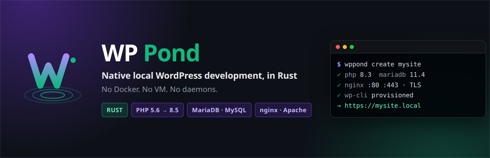
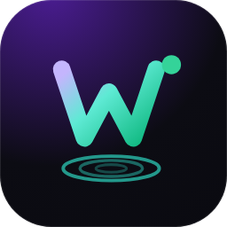
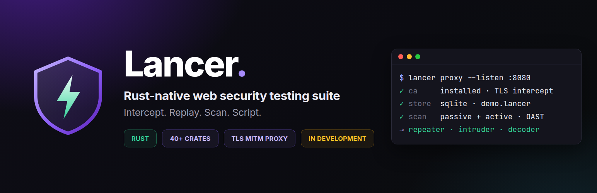
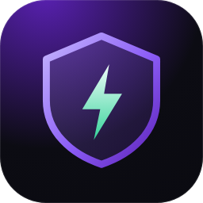
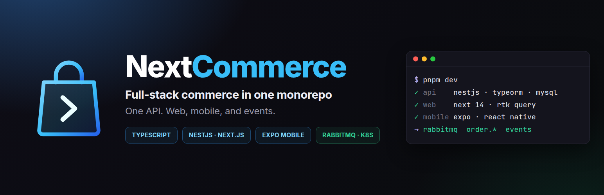
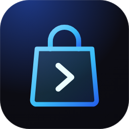

<h1 align="center">
  
</h1>

  
  
  
  

---

## 💻 About Me

I'm a **Software Engineer** from **Dhaka, Bangladesh 🇧🇩** with nearly **5 years** of shipping production web and mobile products end to end — the API, the front end, the mobile app, and the infrastructure underneath them.

Most of what I build for myself now is in **Rust**: developer tooling and security tooling that has to be fast, predictable, and safe to leave running. The rest is **full-stack TypeScript** — NestJS services, Next.js front ends, and React Native apps that all talk to the same API.

I care about **clean architecture, thoughtful UX, and code that ages well**. I'd rather ship one tool people actually depend on than ten demos, and I'd rather be honest about what's finished than inflate a README.

🔭 **Currently building** — [WP Pond](https://naymul.com/wp-pond/), a native (non-Docker) local WordPress development environment in Rust, and [Lancer](https://github.com/NHTanvir/lancer), a Rust-native web security testing suite.

---

## 🚀 Core Expertise

<table>
  <tr>
    <td width="50%" valign="top">

### 🌟 What I Build
- 🦀 **Rust systems & desktop tooling** — multi-crate Cargo workspaces, Tauri desktop GUIs, process supervision, TLS and reverse-proxy plumbing
- 🧩 **Full-stack web engineering** — NestJS/TypeScript APIs, Next.js front ends, MySQL, Redis, and event-driven services
- 📱 **Cross-platform mobile** — React Native / Expo apps running against the same API as the web client
- 🛡️ **Security tooling** — proxies, scanners, and browser extensions for *authorized* testing

    </td>
    <td width="50%" valign="top">

### 🎯 What Drives Me
- 💡 **Always leveling up** — new tech, sharper patterns, better craft
- 🏗️ **Real-world impact** — tools people actually depend on, not toys
- 🔍 **Honest engineering** — accurate status over marketing claims
- 🤝 **Great teams** — shipping great work, together

    </td>
  </tr>
</table>

---

## 🛠️ Technical Stack

  
  
  
  
  
  
  
  
  
  
  
  
  
  

| Skill | How I Use It |
|-------|--------------|
| **Rust** | Where my own projects live — WP Pond (12-crate workspace + Tauri 2 GUI), Lancer (40+ crate workspace), Idorra, and 30 companion CLI tools |
| **TypeScript** | Strict TS end to end in NextCommerce — the NestJS API, the Next.js web app, and the Expo mobile client |
| **NestJS** | Modular REST APIs with JWT + Google OAuth, role-based guards, interceptors, and TypeORM over MySQL |
| **Next.js / React** | App Router front ends with Redux Toolkit and RTK Query for all data fetching |
| **React Native** | One Expo codebase sharing the web client's API and auth flow |
| **PHP** | Five years of production CMS backends, custom plugins, and eCommerce integrations |
| **JavaScript** | Chrome MV3 extensions built on the Chrome DevTools Protocol |
| **Docker / Kubernetes** | Multi-stage builds plus Deployment, Service, HPA, Ingress and StatefulSet manifests |
| **RabbitMQ** | Fanout event pipeline between an API and a standalone notifications service |
| **Astro** | My own site and blog, [naymul.com](https://naymul.com) |

---

## 📌 Featured Projects

### 🪷 [WP Pond](https://naymul.com/wp-pond/) — Native Local WordPress Development, in Rust

  

<table>
  <tr>
    <td width="120" align="center" valign="middle">
      
    </td>
    <td valign="middle">
      

        My flagship project — a <b>host-based (non-Docker) local development tool</b> and an
        alternative to Local/LocalWP, built as a <b>12-crate Rust workspace</b> with a Tauri 2 desktop GUI.
      

      

        WP Pond supervises bundled <b>PHP, MariaDB/MySQL, and nginx/Apache</b> binaries directly on the host —
        no Docker, no VM, no daemons. It routes <code>*.local</code> domains through an nginx reverse proxy on
        ports 80/443, terminates TLS with a locally-trusted CA, and provisions sites through WP-CLI. Every
        site picks its own <b>PHP (5.6 → 8.5)</b>, database engine, and web server — each changeable on an
        existing site and downloaded on demand.
      

      

        Also ships site clone, export/import, blueprints, one-click admin login, an Xdebug toggle, Adminer,
        and Mailpit mail capture. Targets <b>Windows</b> and <b>Ubuntu/Debian x86_64 (16.04+)</b>.
      

      

        
        
        
      

      

        
        
        
        
        
      

    </td>
  </tr>
</table>

 

### 🛡️ [Lancer](https://github.com/NHTanvir/lancer) — Rust-Native Web Security Testing Suite

  

<table>
  <tr>
    <td width="120" align="center" valign="middle">
      
    </td>
    <td valign="middle">
      

        A <b>Rust-native web application security testing suite</b> — my own take on what a Burp Suite
        alternative looks like when it's built for speed from the start. It's a Cargo workspace of
        <b>40+ crates</b>: a TLS MITM proxy with CA management, interception and match-and-replace;
        SQLite-backed history and project files; repeater, intruder, decoder, comparer and sequencer
        tooling; a passive and active scanner with an out-of-band (OAST) client; a Rhai-based scripting
        engine; plus a desktop GUI and a headless CLI.
      

      

        Crates for <b>LLM/MCP scanning</b>, <b>eBPF probes</b>, mobile and IaC analysis are scaffolded and in progress.
        <b>Status: early, active development</b> — the roadmap lives in <code>plan.md</code>, and I'd rather say that
        than pretend it's 1.0.
      

      

        Around it sits the <b>Lancer toolkit</b>: <b>30 public companion repos</b>, each re-implementing a
        standard security tool in Rust — <code>sqlmap</code>, <code>nmap</code>, <code>subfinder</code>,
        <code>naabu</code>, <code>dnsx</code>, <code>frida</code>, <code>ghidra</code>, <code>semgrep</code>,
        <code>wireshark</code> and more. For <b>authorized testing only</b>.
      

      

        
        
        
      

      

        
        
        
        
      

    </td>
  </tr>
</table>

 

### 🛒 [NextCommerce](https://github.com/NHTanvir/NextCommerce) — Full-Stack Commerce Platform

  

<table>
  <tr>
    <td width="120" align="center" valign="middle">
      
    </td>
    <td valign="middle">
      

        A <b>production-shaped full-stack commerce platform</b> in one pnpm monorepo — four apps on a single
        API: a <b>NestJS 10</b> backend (TypeORM + MySQL 8, JWT and Google OAuth, role-based guards,
        validation pipes), a <b>Next.js 14 App Router</b> web client (Redux Toolkit + RTK Query), a
        <b>React Native / Expo</b> mobile client, and a notifications service.
      

      

        The interesting part is everything around the features: <b>RabbitMQ</b> fanout events published on every
        order state change, <b>Redis</b> caching with graceful fallback, <b>Pino</b> structured logging and
        <b>Prometheus</b> metrics, multi-stage <b>Docker</b> builds, and <b>Kubernetes</b> manifests with an HPA —
        all gated by GitHub Actions running lint, type-check, tests and image builds.
      

      

        
        
        
      

      

        
        
        
        
        
        
        
      

    </td>
  </tr>
</table>

---

## 🧰 Also Built

| Project | What it is |
|---------|------------|
| 🔎 **[Idorra](https://github.com/NHTanvir/Idorra)** | Rust CLI for **authorized** IDOR and broken-access-control testing. Every request passes one choke point: scope allowlist → dry-run (on by default) → token-bucket rate limit → JSON audit log. Redirects disabled, no shared cookie jar, secrets redacted. |
| 🧪 **[Lancer toolkit](https://github.com/NHTanvir?tab=repositories&q=lancer)** | 30 public repos re-implementing standard security tools in Rust — `sqlmap`, `nmap`, `subfinder`, `naabu`, `dnsx`, `frida`, `ghidra`, `semgrep`, `wireshark`, `mobsf` and more. In development. |
| 🧩 **Browser security extensions** | Six Chrome MV3 extensions for authorized testing: [Request Tamper & Replay](https://github.com/NHTanvir/request-tamper), [Client Storage Watch](https://github.com/NHTanvir/client-storage-watch), [SPA State Explorer](https://github.com/NHTanvir/spa-state-explorer), [Role UI Diff](https://github.com/NHTanvir/role-ui-diff), [Hidden UI Revealer](https://github.com/NHTanvir/hidden-ui-revealer), [postMessage Spy](https://github.com/NHTanvir/postmessage-spy). |
| 🚦 **[Easy Redirect](https://github.com/NHTanvir/easy-redirect)** | Chrome extension that redirects blocked sites to a page of your choosing — domain, path, wildcard, keyword and regex rules, colour-coded groups, allowlist mode, and incognito control. |
| 🌐 **[naymul.com](https://github.com/NHTanvir/naymul-website)** | My site and blog — Astro + Keystatic. |

---

## 📊 GitHub in Numbers

  
  

  
  

### 📈 Contribution Activity

  

---

## 🤝 Let's Connect & Build Together

- 💬 **Let's talk shop** — Rust, TypeScript, system design, or security tooling: I'm always up for a good technical conversation
- 🚀 **Got an ambitious project?** I'm always up for meaningful collaborations
- 📚 **I teach what I know** and learn from everyone I work with
- 🌟 **Open source matters** — let's build things that outlast us

  
  
  
  
  
  

  📬 <a href="mailto:naymulhasantanvir10@gmail.com"><b>Drop me a line</b></a> — always happy to talk shop!

---

## 💡 Fun Fact

> When I'm not shipping code, you'll find me chasing the latest in tech, tinkering with a new framework, or soaking in Dhaka's vibrant street culture. For me, **every commit is a chance to grow** — both as an engineer and as a human.

---

  <i><b>"Building the future, one commit at a time."</b></i>  🚀

  

